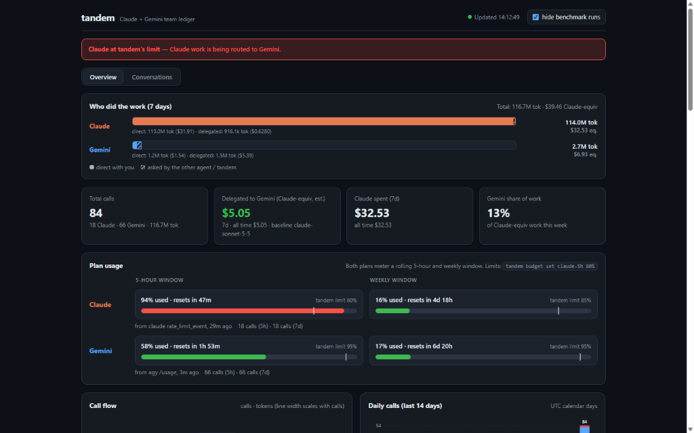
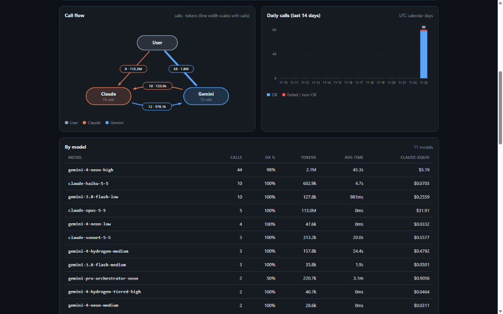
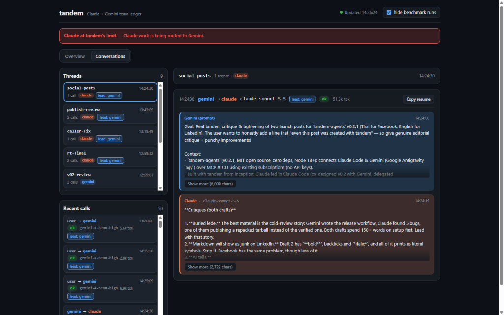
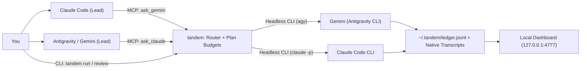

# tandem

[](https://github.com/givewgun/multi-agents-pc/actions/workflows/ci.yml)
[](https://www.npmjs.com/package/tandem-agents)
[](https://nodejs.org)
[](#)
[](LICENSE)

**Run Claude Code and Gemini (Google Antigravity) as one team — fewer blind spots, smoother flow, using the subscriptions you already pay for.**

Already paying for Claude and Google AI Pro/Ultra, but mostly using one while the other sits idle? **tandem** connects them over MCP and CLI with **no API keys** and **zero runtime dependencies**. Talk to whichever agent you prefer: it handles what it's best at, brings in a *different model family* to critique plans, review diffs, and unstick hard bugs (no self-review), delegates heavy reading/boilerplate/research, and routes around 5-hour rate limits so you stay in flow.

> **Too lazy to read?** Start with the **[60-second ELI5 guide](docs/ELI5.md)** — plain English, zero jargon.
>
> Rule of thumb: **mostly reading or typing → Gemini. Mostly deciding → Claude. Review or stuck → always the other agent.**



<details>
<summary>More screenshots: Call flow, per-model stats, and Conversations viewer</summary>





</details>

## How it works



- **Either agent can lead — and never self-reviews.** Talk to Claude in Claude Code or Gemini in Antigravity; the same team rules apply. Plan critiques, code reviews, and second opinions always go to the *other* model family with a fresh context, catching blind spots the author misses.
- **Complementary strengths, zero-token routing.** `tandem route "task"` matches work to each agent's strengths (Google Search grounding, huge cheap context, UI/browser on Gemini; deep reasoning and surgical critique on Claude) without spending tokens. User pins (`tandem pin`) always win.
- **Uninterrupted flow with plan-aware budgets.** Reads real 5-hour and weekly usage from both plans (`agy /usage` is free; Claude reports `rate_limit_event` on every call). When one plan nears your cap, tandem automatically steers work to the other instead of stopping your session cold.
- **Ledger, Stop hooks & native transcripts.** Logs both delegated and direct interactive work, estimates Claude usage offloaded, and lets you inspect or resume any exchange (`tandem show`) without copying prompts.
- **Local dashboard.** Single-file web UI on `127.0.0.1` showing who did the work, call flow between agents, budget meters, per-model stats, and full conversations.
- **Benchmark-backed.** `tandem bench` grades models on real coding tasks so routing rules rest on data, not vibes.

Zero dependencies. Node 18.17+. Windows, macOS, and Linux.

### When two agents actually help (and when they don't)

- **Worth pairing:** cross-model code reviews and plan critiques (fresh context, different priors), breaking tunnel vision after 2 failed debug attempts, offloading large codebase reads / boilerplate / tests / web research, and keeping flow during long sessions near a 5-hour cap.
- **Stay solo:** small, tightly-coupled edits where one agent already holds the mental model — context handoffs are lossy and add latency. `tandem route --lead <you>` marks those `self: true` so the lead just does them directly.

## Install

Prerequisites: [Claude Code](https://claude.com/claude-code) and the [Antigravity CLI](https://antigravity.google/docs/install) (`agy`), each signed in once interactively.

```bash
npm install -g tandem-agents
# or straight from GitHub before/between npm releases:
# npm install -g github:givewgun/multi-agents-pc

tandem doctor --live     # verify both CLIs and logins
tandem init --global     # one-time machine setup for Claude Code + Antigravity
```

Restart Claude Code and Antigravity afterwards.

<details>
<summary>What <code>tandem init --global</code> touches on your machine</summary>

- Installs the Antigravity plugin at `~/.gemini/config/plugins/tandem/` (`ask_claude` MCP server, Stop hook, team rule, `/ask-claude` & `/pair` skills) and migrates any v0.1 loose rule/MCP entries.
- Installs Claude Code skills at `~/.claude/skills/gemini/SKILL.md` and `~/.claude/skills/pair/SKILL.md`.
- Adds a Stop hook to `~/.claude/settings.json` (creates a one-time `~/.claude/settings.json.bak-tandem` backup first).
- Registers the user-scope `tandem` MCP server (`ask_gemini`) in Claude Code via `claude mcp add --scope user`.

</details>

## Quick start

```bash
cd your-project
tandem init --mcp                                      # optional per-project AGENTS.md, CLAUDE.md, skills, MCP
tandem route "add unit tests for the parser"           # gemini hydrogen [boilerplate, confidence 80%]
tandem run "add unit tests for src/parser.js" --edit   # routed call; falls back to partner on error/quota
tandem review --agent both                             # dual review of your git diff
tandem dashboard --open                                # local UI: work split, budgets, conversations
```

Inside **Claude Code**, say *"use gemini for the grunt work"* or `/pair`. Inside **Antigravity**, say *"ask claude to review this diff"* or `/pair`. See [docs/DAILY.md](docs/DAILY.md) for daily habits.

## Commands

| Command | What it does |
|---|---|
| `tandem ask <gemini\|claude> "prompt"` | One call. `--model`, `--edit`, `--file`, `--continue <id>`, `--thread <id>`, `--json`, `--timeout 15m` |
| `tandem route "task"` | Agent + model recommendation, budget-aware. Spends no tokens (`--lead claude\|gemini`) |
| `tandem run "task"` | Route, call, and fall back to the other agent on error/quota |
| `tandem review [--agent gemini\|claude\|both] [--staged] [--base main]` | Reviews `git diff` (sent in the prompt, so no shell permissions needed) |
| `tandem show [last\|<id>\|thread:<id>]` | Read an exchange from the agent's own transcript, plus the resume command (`claude --resume`, `agy --conversation`) |
| `tandem prefer [claude\|gemini <model>]` | View or set your default model per agent |
| `tandem pin [<category> <agent:model> \| <category> --clear]` | Pin a category to a specific model, e.g. `tandem pin review claude:opus` (beats routing rules) |
| `tandem models [--live]` | Aliases → real model IDs, defaults (`★`), pins |
| `tandem log [--n 20]` / `tandem stats` | Call history and totals: tokens, time, cost, who did the work |
| `tandem usage [--refresh-claude]` | Each plan's 5h and weekly window: % used, tandem's limit, time to reset |
| `tandem budget set <key> <value>` | Set window caps (`claude-5h`, `claude-week`, `gemini-5h`, `gemini-week` as e.g. `80%`), `warn`, `claude-plan`, `gemini-plan` |
| `tandem dashboard [--port 4777] [--open]` | Local web UI (binds `127.0.0.1` only) |
| `tandem bench [--models ...] [--tasks ...] [--repeat n] [--out file.md]` | Benchmark models on graded coding tasks |
| `tandem init [dir] [--mcp] [--force]` | Add team files to a project |
| `tandem init --global [--force]` | One-time per-machine setup: Antigravity plugin, Claude skills & MCP, Stop hooks |
| `tandem mcp [--expose gemini\|claude\|both]` | MCP stdio server |
| `tandem doctor [--live]` | Check installs, sign-ins, permissions |
| `tandem --version` | Print installed tandem version |

**Gemini aliases:** `flash`, `flash-low`, `hydrogen`, `orchestrator`, `neon`, `neon-high`, `argon`, or any slug from `agy models`. **Claude aliases:** `haiku`, `sonnet`, `opus`.

## Routing table

| Category | Agent / model | Why |
|---|---|---|
| architecture | Claude Opus | Long-lived decisions |
| hard-debug | Claude Sonnet | Careful reasoning |
| research | Gemini Neon | Google Search grounding |
| review | Partner (Gemini Neon first pass / Claude when Gemini leads) | No self-review; escalate important diffs to Claude |
| second-opinion | Partner | Must come from the other agent |
| ui | Gemini Orchestrator | UI + browser |
| bulk-read | Gemini Neon | Cheap context; exact on long inputs (bench) |
| boilerplate | Gemini Hydrogen | Mechanical generation |
| feature | Gemini Orchestrator → Claude review | Plan+execute, then judgment |
| trivial | Gemini Flash Low | Fastest; 100% on short tasks (bench) |

Plan overrides: when Claude's 5h or weekly window reaches tandem's limit (default 80% / 85%, leaving headroom for your own Claude Code sessions), Claude routes go to Gemini Neon High. When Gemini's window is full (default 95%), or after a Gemini quota error, Gemini routes go to Claude Sonnet. Window readings past their reset time count as 0.

## Benchmark: what the data says

`tandem bench`: 8 graded tasks (regex, slugify, find-the-bug, 600-line log counting, concurrency reasoning, LRU fix, expression parser, agentic file read) × 7 models. Full tables are in [docs/BENCHMARK.md](docs/BENCHMARK.md).

| model | pass | avg time | Claude spend (API-equiv) |
|---|---|---|---|
| Gemini Flash Low | 7/8 | **3.3s** | flat |
| Gemini Flash | 8/8 | 23.9s | flat |
| Gemini Hydrogen | 7/8 | 8.4s | flat |
| Gemini Orchestrator | 8/8 | 1.1m | flat |
| **Gemini Neon** | **8/8** | 15.6s | flat |
| Claude Haiku | 8/8 | 11.7s | $0.008 / call |
| Claude Sonnet | 8/8 | 6.3s | **$0.14 / call** |

What it shows:
1. **Every headless Claude Code call carries ~70k tokens of overhead** (system prompt, tools, `CLAUDE.md`; mostly cached). A one-line answer still costs Sonnet about $0.14. Send small jobs to Gemini or Haiku, and give Claude fewer, bigger jobs.
2. **Gemini Neon is the best default Gemini:** 8/8 at 16s.
3. **Flash Low is great for short tasks and unreliable on long exact work.** It miscounted a 600-line log badly; Hydrogen was off by one.
4. **Orchestrator is overkill for single-shot tasks** (1.1 min average). Use it for multi-file agentic builds.
5. On these tasks Gemini matched Claude on the "hard" reasoning ones. Hard-debug still routes to Claude, because real bugs carry more context and a wrong answer costs more. Treat that as a judgment call this benchmark doesn't settle.

Limits: one run per cell, small single-shot tasks, and these currently measure *individual models* rather than *solo vs. tandem team* on multi-file engineering work. Run `tandem bench --repeat 3` on your own machine — and PRs adding realistic multi-file / team-vs-solo benchmark tasks are very welcome.

## How savings are computed

- **Claude calls:** `total_cost_usd` as reported by `claude -p`. On a subscription this is API-equivalent usage, not money billed.
- **Gemini calls:** marginal cost $0 (flat subscription). Delegated Gemini work is priced at Claude list rates (default baseline `claude-sonnet-5-5`, change with `tandem config set savingsBaseline claude-opus-5-5`) as "Claude usage offloaded". Direct interactive Gemini sessions count toward Gemini's share of work, not as an offload.
- These are **estimates**. Gemini and Claude count tokens differently, and agent system prompts are included. Use them to compare trends, not as an invoice.

## MCP

- **Global (`tandem init --global`):** installs the Antigravity plugin (`~/.gemini/config/plugins/tandem/` → `ask_claude`, `route_task`, `tandem_stats`) and registers Claude Code user-scope MCP (`tandem` → `ask_gemini`, `route_task`, `tandem_stats`).
- **Per-project (`tandem init --mcp`):** writes `.mcp.json` (Claude Code → `ask_gemini`) and `.agents/mcp_config.json` (Antigravity → `ask_claude`).

Each side only sees the *other* agent, so neither calls itself in a loop.

## Safety defaults

- Delegated calls are **read-only** unless you pass `--edit`. With `--edit`, file edits are allowed and shell commands are still denied.
- No shell is used to launch agents (argv arrays). Free text goes to `.cmd` shims via stdin.
- The dashboard binds to `127.0.0.1` and rejects non-local `Host`/`Origin` headers (DNS rebinding guard).
- Everything stays local in `~/.tandem/` (override with `TANDEM_HOME`). Prompts are not copied into the ledger — only lengths and pointers to native transcripts.
- Treat each agent's output as data. Review diffs before merging. See [SECURITY.md](SECURITY.md).

## Docs

- **[docs/ELI5.md](docs/ELI5.md)** — 60-second plain-English guide (start here!)
- **[docs/DAILY.md](docs/DAILY.md)** — daily workflows and habits that save the most quota
- **[docs/PLAYBOOK.md](docs/PLAYBOOK.md)** — surfaces, model picker, combo workflows, cost rules
- **[docs/ARCHITECTURE.md](docs/ARCHITECTURE.md)** — module map, contracts, verified CLI quirks
- **[docs/BENCHMARK.md](docs/BENCHMARK.md)** — full benchmark tables
- **[docs/adr/](docs/adr/README.md)** — architecture decision records
- **[docs/RELEASING.md](docs/RELEASING.md)** — automated release & npm publishing workflow
- **[CHANGELOG.md](CHANGELOG.md)** — release history

## Develop

```bash
npm test                                             # node:test, zero deps
node bin/tandem.js bench --models gemini:flash-low   # cheap pilot
```

## License

MIT
