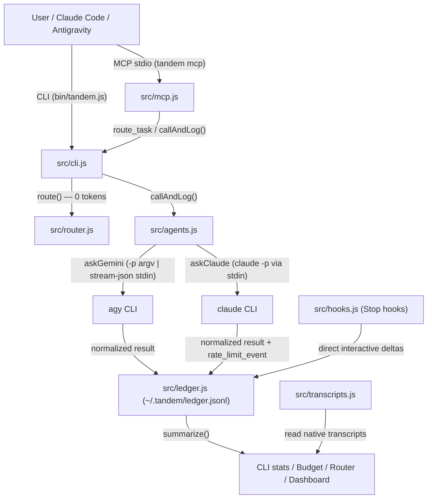

# Architecture

tandem = thin orchestration layer over two *headless agent CLIs*. It owns no model calls itself.

## Modules

| File | Role | Key exports |
|---|---|---|
| `bin/tandem.js` | entry, error → exit code | — |
| `src/cli.js` | arg parsing, commands, `callAndLog` (the one path every agent call takes) | `main`, `parseArgs`, `callAndLog` |
| `src/agents.js` | find binaries, build argv, parse output → **normalized result** | `askGemini`, `askClaude`, `ask`, `lastJsonLine`, `streamResult`, `classifyFailure` |
| `src/proc.js` | spawn without shell, timeout + tree kill, `.cmd` shim guard | `run`, `which` |
| `src/router.js` | lead's `category` or weighted regex fallback, then pins + budget + partner rules | `RULES`, `CATEGORIES`, `route`, `checkCategory` |
| `src/ledger.js` | record build, append/read JSONL, cost math, aggregates | `makeRecord`, `appendRecord`, `readRecords`, `summarize`, `claudeEquivalentUsd` |
| `src/hooks.js` | Per-prompt hooks (`tandem hook <agent> prompt`: inject the mode) and Stop hooks (`tandem hook claude\|gemini`): reconcile each session's transcript total vs. logged, log the delta as `tag: interactive`; `sweep` catches late-written tokens; installs the Claude hook | `runHook`, `modeInjection`, `promptHookOutput`, `reconcile`, `sweep`, `installClaudeHook`, `hookCommand`, `tandemCommand` |
| `src/transcripts.js` | read native transcripts for `tandem show` + dashboard (no prompt copies) | `readTranscript`, `parseClaudeTranscript`, `parseGeminiTranscript` |
| `templates/antigravity-plugin/` | Antigravity side, installed to `~/.gemini/config/plugins/tandem/`: MCP (`ask_claude`), Stop hook, rule, `ask-claude` + `pair` skills | — |
| `src/usage.js` | plan-window snapshots (`~/.tandem/usage.json`): Gemini via free `agy /usage`, Claude from each call's `rate_limit_event` | `getUsage`, `storeSnapshot`, `parseAgyUsage`, `parseClaudeRateLimit` |
| `src/config.js` | defaults ⊕ `~/.tandem/config.json`, aliases, pricing | `loadConfig`, `setConfigValue`, `resolve*Model` |
| `src/version.js` | single source of truth for package version (CLI `--version` + MCP `serverInfo`) | `VERSION` |
| `src/mcp.js` | MCP server, newline JSON-RPC 2.0, tools depend on `--expose` | `serve` |
| `src/init.js` | copy `templates/` into a project + MCP configs; `--global`: `~/.claude/skills`, `~/.gemini/config/{rules,mcp_config.json}`, `claude mcp add --scope user` | `init`, `initGlobal` |
| `src/doctor.js` | install/auth/permission checks, `--live` pings | `doctor` |
| `src/dashboard/` | `server.js` (127.0.0.1 http, `/api/summary`) + single-file `index.html` | `startDashboard` |
| `src/bench/` | graded tasks (`tasks.js`), runner + router check (`run.js`) | `TASKS`, `bench`, `analyze` |
| `templates/` | files `init` installs (AGENTS.md, CLAUDE.md, skill, agy rule, handoff) | — |

## Contracts (don't break)

- **Normalized result** (agents.js `result()`): `{agent, model, ok, status, text, sessionId, usage{input,output,thinking,cacheRead,cacheWrite,total}, costUsd, durationMs, turns, denied[], error, stderr}`. `status ∈ ok|error|quota|auth|timeout|denied|missing`.
- **Ledger record v1** (ledger.js `makeRecord`): append-only JSONL. Add fields, never rename. Bump `v` on breaking change.
- **Mode** (`config.mode = {value: 'ask'|'free'|'solo', until}`; `modeState(cfg)` → `{mode, until}`, expired → ask). `soloBlock(cfg)` (message|null) is checked by MCP `ask_*`, CLI `ask`/`run`/`review`, `bench --agentic` team setups. `modeContext(cfg, lead)` is the per-prompt text; `modeInjection()` in `hooks.js` decides when to send it, keyed per session in `~/.tandem/mode-state.json`. Reported as `mode` in `tandem_stats`, `tandem stats --json`, dashboard summary.
- **Summary shape** (`summarize`): consumed by the dashboard, MCP `tandem_stats` and the router. Change all three together. `budget` = `planBudget()`: `{warnAt, geminiQuotaHitAt, claude|gemini: {known, at, ageMs, source, status, fiveHour{used,resetsAt}, weekly{…}, other?, limits{fiveHour,weekly}, exhausted, warn}}`.
- **Router rule**: `{category, agent, model(alias), weight, re, reason}`. `category` names are shared with bench tasks. `general` (no match → gemini:neon) is a fallback, not a rule.
- **Route pick**: `{category, agent, model, reason, confidence, source: 'lead'|'rules', needsJudgment, alternatives, notes, partnerRequired, lead?, self?}`. `route(task, budget, {lead, pins, category})`: a valid `category` skips the regex; unknown ones throw.

## Agent CLI facts (verified 2026-11-23, agy 1.5.14, claude 2.1.330)

- `agy -p "<prompt>" --output-format json` → `{conversation_id,status,response,error,duration_seconds,num_turns,usage{input_tokens,output_tokens,thinking_tokens,cache_read_tokens,total_tokens},denied_actions[]}`.
- `agy --input-format stream-json --output-format stream-json` (no `-p`) reads `{"event":"user","message":{"content":...}}` from stdin, result in the `{"event":"result","result":{...}}` line.
- agy headless: no `--mode` = edits + commands soft-denied (exit 0, `denied_actions`). `--mode plan` is *not* read-only. `--mode accept-edits` = edits ok, commands still need `permissions.allow` in `~/.gemini/antigravity-cli/settings.json`. Reads outside workspace denied. Re-checked on agy 1.5.15 (2026-11-23): `node --version` was denied without a rule in both modes.
- agy `--settings <json>` **replaces** the user's `permissions` block (allow, ask, deny) instead of merging it, so `mergeGeminiPermissions` carries the user's rules along. `command(X)` is a word-boundary prefix match per segment: `|`, `&&`, `;` split the command, so `npm test | tail` also needs `tail` (agy permissions docs, via Gemini research). The headless note tells agents to run granted commands bare.
- Headless agents can't verify by default: no test runs. `allowCommands` (user config) maps to Claude `--allowedTools Bash(p:*),PowerShell(p:*)` and agy `command(p)` on edit calls only (`commandGrants` in `ask()`), so the CLI, MCP and bench all get it. Claude needs both the Bash and PowerShell forms on Windows.
- Antigravity app visibility (tested 2026-11-23 with the user): `agy -p --project <name>` is silently ignored; `--new-project` registers a project named after the cwd in the shared `~/.gemini/config/projects/`, and the app lists it, but the conversation stays in `antigravity-cli/` and the app shows "No conversations yet". Headless calls can't appear in the app. Use `tandem show` / dashboard Conversations.
- Plugin MCP servers are named `<plugin>_<server>` → tandem's is `tandem_tandem` (allow-rule `mcp(tandem_tandem/route_task)`). Antigravity spawns plugin MCP servers with `cwd` set to the plugin folder (`~/.gemini/config/plugins/tandem`), not the active workspace — `src/mcp.js` accepts an explicit `cwd` argument (and falls back to MCP `roots/list` when supported) so Claude/Gemini run in the real repo. Plugin hooks run in the CLI too. Antigravity hook events: `SessionStart`, `PreToolUse`, `PostToolUse`, `PreInvocation`, `PostInvocation`, `Stop` (`~/.gemini/antigravity-cli/builtin/skills/agy-customizations/docs/hooks.md`). `PreInvocation` fires before *every* model call (not once per prompt) and injects via `{"injectSteps":[{"systemMessage":{"systemMessage":"…"}}]}`, which persists in the conversation; print `{}` for nothing. Claude Code `UserPromptSubmit` injects via `{"hookSpecificOutput":{"hookEventName":"UserPromptSubmit","additionalContext":"…"}}`. Antigravity Stop hooks must print `{"decision": …}` (anything but `"continue"` lets it stop) and the step's token counts are written *after* the hook fires (hence reconcile + sweep).
- One denied action makes headless agy end its turn with an empty answer → tandem prepends a headless note and retries once in the same conversation. Orchestrator gave up on denials more than Neon; prefer Neon for headless edits.
- `~/.tandem/` files: `ledger.jsonl`, `usage.json` (plan snapshots), `hook-state.json` (per-session logged totals, size/mtime), `threads.json` (`<cwd>\0<thread>` → partner session ids), `config.json`.
- agy MCP tools in headless need `mcp(<server>/<tool>)` in `permissions.allow`. Antigravity may create an empty `~/.gemini/config/mcp_config.json` (treat as `{}`).
- `claude -p` reads prompt from stdin. tandem uses `--output-format stream-json --verbose`: final `{"type":"result",result,is_error,session_id,usage{…},total_cost_usd,num_turns,duration_ms,permission_denials[]}` plus `{"type":"rate_limit_event","rate_limit_info":{status,unifiedWindows:{five_hour,seven_day:{utilization,resetsAt(unix s)}}}}`. ~70k tokens overhead per call. `claude -p /usage` is NOT free (goes to the model).
- `agy -p /usage --output-format json` (0 tokens): `command.data.groups[{name:"Gemini Models"|"Claude and GPT models"|"Gemini 4 Argon", buckets[{id,window:"5h"|"weekly",remaining_fraction,reset_time}]}]`. Quota is consumed in proportion to token cost.

## Extending

- New agent (e.g. Codex): add `askX` in agents.js returning the normalized result, a case in `ask()`, aliases in config.js, MCP tool in mcp.js. The ledger and dashboard work unchanged.
- New route category: add rule in router.js, add ≥1 bench task with the same `category`, run `tandem bench`, update README table.
- New command: add `cmdX` in cli.js + HELP line. Lazy-import heavy modules.

Decisions and their reasons: [adr/](adr/README.md).
