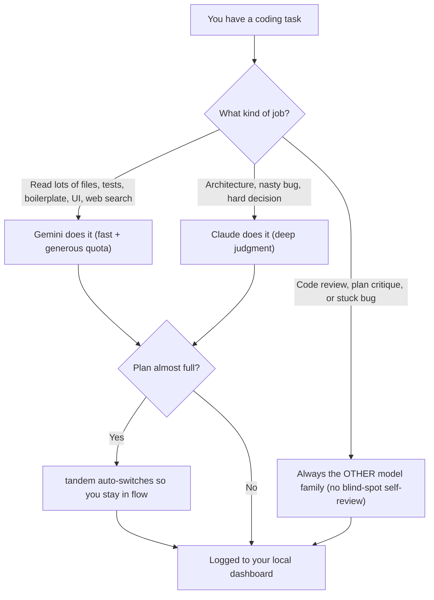
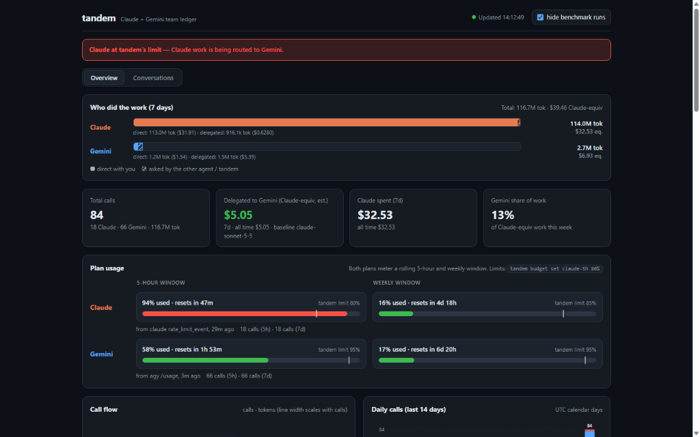

# tandem — Explain Like I'm 5 (60-second version)

Too lazy to read the full README? You're in the right place.

## The 1-sentence pitch

You already pay for **two different AI coders** (Claude + Gemini), so **tandem** gives them a walkie-talkie to work as a real pair — **catching each other's blind spots, splitting tasks by strength, and keeping you shipping when one hits its 5-hour limit.**

## The analogy

Think of building a house with two contractors you already pay a flat monthly fee:

- **Gemini (Google Antigravity)** is fast, has a huge memory, searches Google, handles browser/UI work, and has a generous quota. Great for reading 50 files, writing boilerplate/tests, web research, and fast first-pass reviews.
- **Claude (Claude Code)** is the sharp senior reviewer/architect with a tighter 5-hour cap. Great for design trade-offs, tricky bugs, and catching subtle edge cases in a diff.

Using only one wastes the other — and asking one AI to review its *own* work means it misses its own blind spots. **tandem** lets whichever one you're talking to call the other when a second brain or different strength pays off — using your existing subscriptions (no API keys).



## When it helps (and when to stay solo)

- **Great for pairing:** cross-model diff/plan reviews (two model families rarely make the exact same mistake), getting unstuck after 2 failed bug attempts, big repo reads / test writing / Google-grounded research, and avoiding 5-hour limit walls.
- **Just stay solo:** tiny or tightly-coupled edits where one agent already has all the context — handing off notes just adds overhead.

## Setup (3 commands, 1 minute)

You need **Claude Code** and **Antigravity CLI (`agy`)** installed and logged in once. Then run:

```bash
npm install -g tandem-agents
tandem doctor --live     # checks both agents can answer
tandem init --global     # connects Claude Code <-> Antigravity everywhere
```

Restart Claude Code and Antigravity. Done.

## What do I actually do every day?

Delegation is **opt-in** — each agent works alone until you ask. Just chat normally in **Claude Code** or **Antigravity**:

| What you want | What you say in chat |
|---|---|
| Catch blind spots before committing | *"Get Claude to review this diff"* (or *"Ask Gemini for a second opinion"*) |
| Break out of a stuck bug loop | *"Ask the other agent for 3 alternative hypotheses"* |
| Offload tedious work | *"Use Gemini for the tests and boilerplate"* |
| Save context on big repos | *"Ask Gemini to map this repo and summarize it"* |
| Work as a pair | *"/pair"* |
| Let the lead delegate by judgment | *"use tandem freely"* (this task) or *"/tandem free"* (every prompt; *"/tandem ask"* to reset, *"/tandem solo"* to block all calls) |

Or from your terminal (only 4 commands worth remembering):

```bash
tandem route "write unit tests"   # asks who should do it (free, 0 tokens)
tandem run "fix typo" --edit      # picks the best agent + runs it
tandem review --agent both        # both agents review your git diff
tandem dashboard --open           # local UI: call flow, budgets & chats
```



## Wait… (quick FAQ)

- **Will this cost me extra money?** No. It drives the `claude` and `agy` CLIs using the subscriptions you already have — no API keys.
- **Will the other agent randomly wreck my code?** No. Delegated calls are **read-only by default**. An agent can only edit files if you explicitly pass `--edit`, and shell commands stay blocked by default (unless you opt in via `allowCommands`).
- **Can I override what tandem picks?** Yes: `tandem prefer gemini neon-high` sets your default, and `tandem pin review claude:opus` locks any category to your favorite model.
- **How do I see what they said to each other?** Run `tandem show last` or open `tandem dashboard --open` → **Conversations** tab. Nothing leaves your machine.

Want the deeper details? Next up: [Daily habits](DAILY.md) · [Playbook](PLAYBOOK.md) · [Full README](../README.md).
