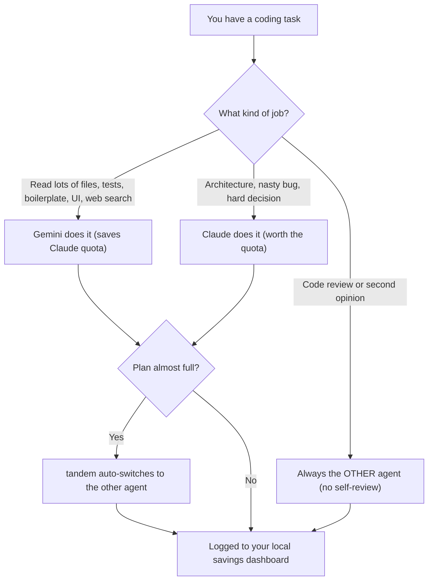

# tandem — Explain Like I'm 5 (60-second version)

Too lazy to read the full README? You're in the right place.

## The 1-sentence pitch

You already pay for **two AI coders** (Claude + Gemini), so **tandem** gives them a walkie-talkie to split the work — **Gemini does the heavy lifting, Claude makes the hard calls**, and neither runs out of quota as fast.

## The analogy

Think of building a house with two contractors you already pay a flat monthly fee:

- **Gemini (Google Antigravity)** is fast, has a huge memory, searches Google, and has a generous quota. Great for reading 50 files, writing boilerplate/tests, building UI, and doing first-pass code reviews.
- **Claude (Claude Code)** is the senior architect with a tighter weekly limit. Great for big design decisions, nasty bugs, and final sanity checks.

Normally, you only talk to one of them and waste half of what you pay for. **tandem** lets whichever one you're talking to call the other when it makes sense — automatically, using your existing subscriptions (no API keys).



## Setup (3 commands, 1 minute)

You need **Claude Code** and **Antigravity CLI (`agy`)** installed and logged in once. Then run:

```bash
npm install -g tandem-agents
tandem doctor --live     # checks both agents can answer
tandem init --global     # connects Claude Code <-> Antigravity everywhere
```

Restart Claude Code and Antigravity. Done.

## What do I actually do every day?

Just chat normally in **Claude Code** or **Antigravity**:

| What you want | What you say in chat |
|---|---|
| Offload tedious work | *"Use Gemini for the tests and boilerplate"* |
| Save Claude context | *"Ask Gemini to map this repo and summarize it"* |
| Double-check your work | *"Get a second opinion from Claude"* (or *"from Gemini"*) |
| Work as a pair | *"/pair"* |
| Use a specific model | *"Ask Gemini with neon-high"* |

Or from your terminal (only 4 commands worth remembering):

```bash
tandem route "write unit tests"   # asks who should do it (free, 0 tokens)
tandem run "fix typo" --edit      # picks the best agent + runs it
tandem review --agent both        # both agents review your git diff
tandem dashboard --open           # pretty charts of usage, savings & chats
```

## Wait… (quick FAQ)

- **Will this cost me extra money?** No. It drives the `claude` and `agy` CLIs using the subscriptions you already have — no API keys.
- **Will the other agent randomly wreck my code?** No. Delegated calls are **read-only by default**. An agent can only edit files if you explicitly pass `--edit`, and shell commands stay blocked.
- **Can I override what tandem picks?** Yes: `tandem prefer gemini neon-high` sets your default, and `tandem pin review claude:opus` locks any category to your favorite model.
- **How do I see what they said to each other?** Run `tandem show last` or open `tandem dashboard --open` → **Conversations** tab. Nothing leaves your machine.

Want the deeper details? Next up: [Daily habits](DAILY.md) · [Playbook](PLAYBOOK.md) · [Full README](../README.md).
